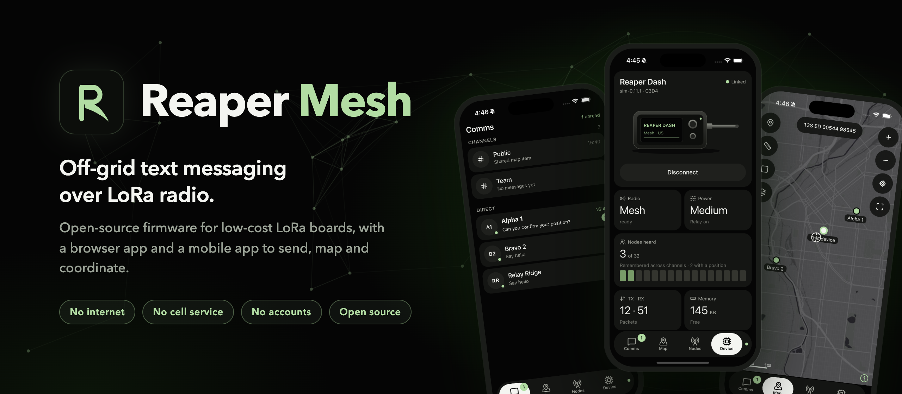
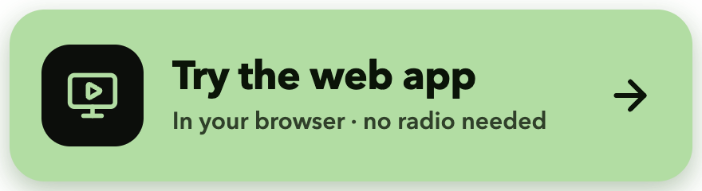
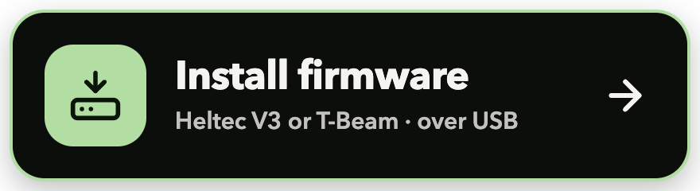
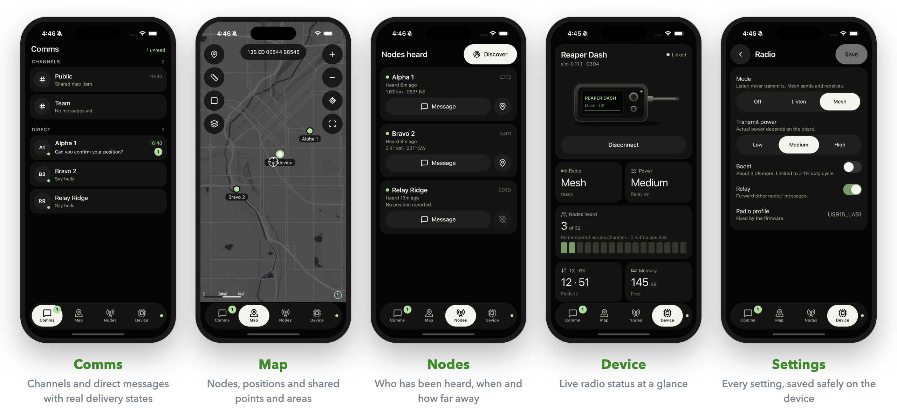
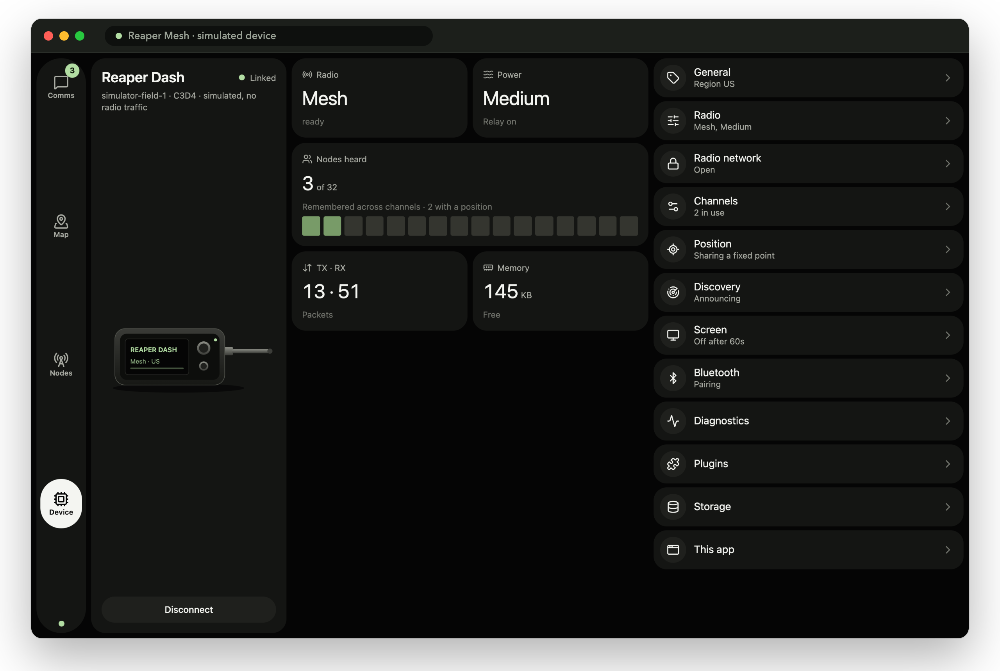
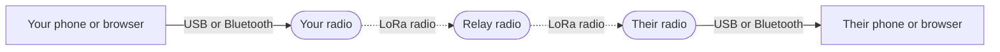

<p align="center">
  
</p>

<p align="center">
  <a href="LICENSE"></a>
  <a href="https://github.com/justingreerbbi/reaper-mesh/actions/workflows/checks.yml"></a>
  <a href="docs/overview/changelog.md"></a>
  <a href="docs/overview/status.md"></a>
</p>

<p align="center">
  <a href="#quick-start"><strong>Quick start</strong></a> ·
  <a href="docs/overview/how-it-works.md"><strong>How it works</strong></a> ·
  <a href="docs/guides/hardware.md"><strong>Hardware</strong></a> ·
  <a href="docs/README.md"><strong>Docs</strong></a> ·
  <a href="CONTRIBUTING.md"><strong>Contribute</strong></a>
</p>

<br>

**Reaper Mesh** lets a group of people text each other over radio when there is no internet and
no cell service. Each person carries a small, inexpensive LoRa radio board and uses the web app
or the mobile app to send messages, see each other on a map and stay coordinated, with no
accounts and no cloud.

It is built for teams that need communication they can **depend on**: a deliberately small,
stable firmware core, messages that tell you exactly how far they got, and new features added in
the apps instead of the firmware, so your radios rarely need updating.

<br>

<h3 align="center">Get started in under a minute</h3>

<p align="center">
  <a href="https://reapermesh.com/web/"></a>
  &nbsp;
  <a href="https://reapermesh.com/flash/"></a>
</p>

<p align="center">
  <sub><strong>No hardware yet?</strong> Open the web app and choose <strong>Use simulated device</strong> to explore everything.<br>
  <strong>Have a board?</strong> The installer flashes it in about a minute from Chrome, Edge or Brave. Nothing to download.</sub>
</p>

<br>

## Why Reaper Mesh

- **Works off the grid.** Radio to radio, with no towers, Wi-Fi or servers in between.
- **Honest delivery.** Every message shows *queued*, *transmitted*, *delivered*, *failed* or
  *unknown*, and nothing is ever marked delivered unless the other radio confirmed it.
- **Never sends twice.** If a link drops mid-send, the app asks the radio what happened instead
  of guessing or resending.
- **Private when you need it.** Encrypted channels keep message text between key holders, and
  team networks keep outsiders from reading, sending or relaying on your network.
- **Cheap, open hardware.** Runs on the Heltec WiFi LoRa 32 V3, Heltec Wireless Stick V3 and LILYGO T-Beam V1.2.
- **Open source.** Firmware, apps, protocol and docs, under the Apache 2.0 license.

<br>

## See it in action

<p align="center">
  
</p>

<p align="center"><sub>The Reaper Mesh mobile app, developed in its own repository. The iOS app is in App Store review and Android follows; see <a href="https://reapermesh.com/app/">reapermesh.com/app</a>.</sub></p>

<br>

<p align="center">
  
</p>

<p align="center"><sub>The web portal in this repository. It runs in Chrome, Edge or Brave and connects over USB or Bluetooth.</sub></p>

<br>

## How it works



1. **You write a message** in the app. On an encrypted channel, the app encrypts it first; the
   radio only ever sees scrambled bytes.
2. **Your radio sends it** over LoRa, within an airtime budget so no one floods the channel.
3. **Other radios relay it** a limited number of hops if needed.
4. **Their radio confirms receipt**, and your app shows it as delivered.

The app and the radio speak an open, documented [protocol](docs/reference/protocol.md). The full
picture, in plain language, is in **[How Reaper Mesh works](docs/overview/how-it-works.md)**.

<br>

## What works today

| Status | Feature | What you get |
| :---: | --- | --- |
| ✅ | **Messaging** | Text up to 1,024 bytes, direct and channel, with acknowledgments |
| ✅ | **Channels** | Up to 8 per radio, shared by QR code |
| ✅ | **Channel encryption** | XChaCha20-Poly1305, keys kept only in the apps |
| ✅ | **Team networks** | Private radio networks with automatic key rotation |
| ✅ | **Discovery and positions** | See who is nearby, when they were heard and where they are |
| ✅ | **Map** | Points, areas, measuring and shared map items, with MGRS |
| ✅ | **Bluetooth and USB** | Pair a phone or browser with a passkey shown on the radio |
| ✅ | **On-device screen** | Status pages, button controls, battery and a status light |
| 🧪 | **Relaying through a third radio** | Passes with three radios on a desk; separated radios next |
| 🧪 | **Range and long-run testing** | Planned field tests; see the [roadmap](docs/overview/roadmap.md) |
| 🔜 | **GPS, sleep modes, code plugins, EU band** | On the [roadmap](docs/overview/roadmap.md) |

✅ verified on real hardware · 🧪 built, field testing next · 🔜 planned.
Exact evidence for every line is in [Status](docs/overview/status.md).

<br>

## Quick start

**Try it right now, no radio and no install:** open the **[web app](https://reapermesh.com/web/)** in
Chrome, Edge or Brave and choose **Use simulated device**. The simulated device speaks the real
protocol, so you can send messages, explore the map and change settings exactly as you would with
a board.

**Or run it from source** with [Node.js](https://nodejs.org/) 24 or 25 and Git:

```sh
git clone https://github.com/justingreerbbi/reaper-mesh.git
cd reaper-mesh
npm ci --ignore-scripts
npm run dev:web
```

Open <http://127.0.0.1:5173/> and choose **Use simulated device**. Then try replying to a
message, dropping a point on the map, or breaking the connection on purpose to watch the app
recover. The [Getting started guide](docs/guides/getting-started.md) walks you through it.

<br>

## Use real radios

1. **Get two boards** (three to test relaying): a [Heltec WiFi LoRa 32 V3, Wireless Stick V3
   or LILYGO T-Beam V1.2](docs/guides/hardware.md), 915 MHz version, with antennas.
2. **Install the firmware** from your browser with the
   **[firmware installer](https://reapermesh.com/flash/)**: pick your board, plug it in, click Install.
   Prefer to build it yourself? See [Flashing firmware](docs/guides/flashing-firmware.md).
3. **Connect** each board in the **[web app](https://reapermesh.com/web/)** over USB, and choose a
   radio network in **Device → Radio network**.
4. **Say hello.** Messages show as delivered when the other radio confirms them.

> [!WARNING]
> Always attach the antenna before transmitting. Reaper Mesh supports the **US 915 MHz** band
> only for now.

<br>

## Project status

> [!IMPORTANT]
> Reaper Mesh is a **working prototype** in active development. Two radios exchange messages
> reliably on the bench, three relay through each other on a desk, and encryption and team
> networks work, but relaying, outdoor range and long-running durability have not been
> field-tested, and the security design has not been independently audited. Do not rely on it for emergencies. Until core v1,
> updates may require reflashing all your radios.

What is verified, and how, is tracked honestly in [Status](docs/overview/status.md). What comes
next is in the [Roadmap](docs/overview/roadmap.md).

<br>

## Documentation

| I want to… | Start here |
| --- | --- |
| Understand what Reaper Mesh is | [How Reaper Mesh works](docs/overview/how-it-works.md) |
| Try it without hardware | [Getting started](docs/guides/getting-started.md) |
| Choose and flash a board | [Hardware](docs/guides/hardware.md) · [Firmware installer](https://reapermesh.com/flash/) · [Flashing firmware](docs/guides/flashing-firmware.md) |
| Use the app day to day | [Web portal](docs/guides/web-portal.md) · [Security and privacy](docs/guides/security.md) |
| Extend the map | [Plugins](docs/guides/plugins.md) |
| Build my own app | [Build a mobile app](docs/guides/mobile-apps.md) · [Protocol](docs/reference/protocol.md) |
| Understand the internals | [Radio protocol](docs/reference/radio-protocol.md) · [Architecture](docs/contributing/plan.md) · [Decisions](docs/contributing/decisions.md) |

Everything is indexed in the [documentation home](docs/README.md).

<br>

## Contributing

Contributions are welcome, from a typo fix or a field-test report to a new board. Start with
**[CONTRIBUTING.md](CONTRIBUTING.md)**: it covers setup, the one design principle to know (keep
the firmware small, build features in the apps), commit format and the pull request checklist.

<details>
<summary><strong>Repository layout</strong></summary>

<br>

| Path | What's inside |
| --- | --- |
| [`firmware/`](firmware/) | Embedded C++17 components and the board applications (`heltec-v3`, `heltec-stick-v3`, `tbeam-v12`) |
| [`agents/web/`](agents/web/) | The web portal (TypeScript, Vite, Leaflet) |
| [`agents/flasher/`](agents/flasher/) | The browser firmware installer (TypeScript, Vite, esptool-js) |
| [`packages/protocol/`](packages/protocol/) | The protocol schema, generated bindings and frozen compatibility fixtures |
| [`packages/agent-core/`](packages/agent-core/) | Transport-independent connection, sync, messaging and recovery logic |
| [`packages/simulator/`](packages/simulator/) | Simulated devices for tests and the portal |
| [`tests/`](tests/) | Host tests, including the real C++ firmware code compiled for your computer |
| [`tools/`](tools/) | Firmware build, install and packaging, and hardware test tools |
| [`examples/`](examples/) | Working examples, such as a [map plugin](examples/agents/web/plugins/field-survey/) |
| [`docs/`](docs/README.md) | All documentation |

</details>

<br>

## License

Reaper Mesh is licensed under the [Apache License 2.0](LICENSE). See [`NOTICE`](NOTICE) for
attribution and [Third-party notices](docs/contributing/third-party-notices.md) for bundled
dependencies.

Reaper Mesh uses its own protocol and is not affiliated with or compatible with Meshtastic.

<br>

<p align="center">
  
</p>
