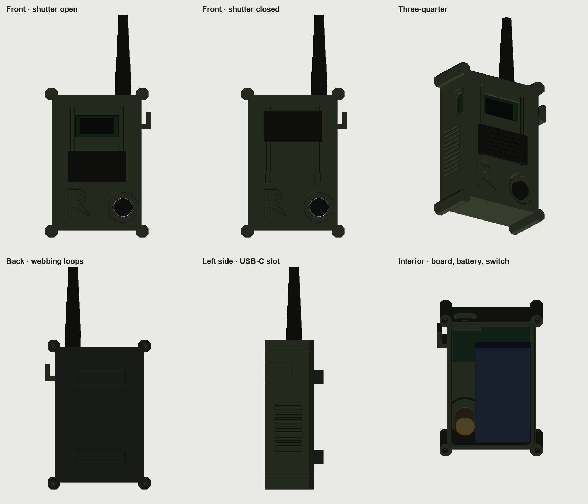

# Tether case for the Heltec V3

A sealed, rugged field case for the Reaper Mesh kit node: a Heltec WiFi LoRa 32 V3 with a 3,000 mAh
battery, a sealed front button, a sliding blackout shutter and a flush SMA jack that takes either a
duck antenna or an extension cable to a pack-mounted antenna.



> [!IMPORTANT]
> This is a first, untested model built from published part sizes. Measure your own board,
> battery, switch and SMA jack, adjust the parameters in `tether.py`, and print the front shell
> once as a fit test before printing the rest.

**Size:** body 58 × 88 × 32 mm; 68.5 × 97 mm across the corner lugs and cable hook.

## Parts to print

All parts are exported in their print orientation and need no supports.

| File | Material | Orientation | Notes |
| --- | --- | --- | --- |
| `stl/front-shell-usb-left.stl` | PETG or ASA | Face down | Use the `-usb-right` version if your board's USB-C is on the right (see [Which shell](#which-shell)) |
| `stl/back-plate.stl` | PETG or ASA | Inner face down | Two loops for 1 in webbing or MOLLE straps |
| `stl/shutter.stl` | PETG | Face down, keys up | Slides in the face grooves |
| `stl/gasket.stl` | TPU 95A | Flat | Or use 1.5 mm O-ring cord instead |
| `stl/usb-plug.stl` | TPU 95A | Flange down | Seals the USB-C slot |
| `stl/window-template.stl` | — | — | Cutting template for the clear window, or print it in clear PETG |

**Suggested settings:** 0.4 mm nozzle, 0.2 mm layers, 6 walls (2.4 mm), 25% gyroid infill. ASA holds
up better in sun and heat; PETG is easier to print. Print TPU slowly.

## Parts to buy

| Part | What to look for |
| --- | --- |
| Heltec WiFi LoRa 32 V3 | 915 MHz version for the US |
| Battery | 1S LiPo, about 3,000 mAh and 65 × 36 × 10 mm, with a protection board and a 2-pin SH1.25 (often sold as "JST 1.25") plug. **Check plug polarity with a meter before connecting: it varies by seller** |
| SMA jack | SMA **female** bulkhead (panel) jack, 1/4-36 thread, with a U.FL (IPEX) pigtail about 10 cm long. It must accept a 3.5 mm panel. Many cheap antennas are RP-SMA; buy SMA |
| Button | IP67 12 mm momentary push button, normally open, 12 mm panel hole, cap no more than about 2.5 mm proud of its bezel |
| Screws | 4 × M2.5 heat-set inserts (3.5–3.6 mm hole, up to 6 mm long) and 4 × M2.5 × 8 socket cap screws |
| Window | 31 × 19 mm piece of 1 mm clear polycarbonate (or print the template in clear PETG) |
| Sealing | Neutral-cure clear silicone for the window; 1.5 mm O-ring cord if you don't print the gasket |
| Padding | 1–2 mm foam pad and double-sided foam tape for the battery |
| Antenna | A 915 MHz SMA male duck antenna, or an SMA extension cable (RG316) to a pack-mounted antenna, plus an SMA dust cap |

## Which shell

Hold the board with the screen reading upright. If the USB-C port is on the **left**, print
`front-shell-usb-left`; if it's on the **right**, print `front-shell-usb-right`. The cable hook
moves to the opposite side automatically.

## Assembly

1. **Inserts.** Press the four heat-set inserts into the corner lugs from the back.
2. **Window.** Lay a thin bead of silicone around the inside lip of the screen opening and press the
   window into its recess from the inside. Let it cure.
3. **SMA jack.** Fit the jack through the top from the inside, with its O-ring or washer under the
   nut in the counterbore. Add a lock washer and a dot of thread-locker, and tighten.
4. **Button.** Fit the switch in the guard well, with its nut inside. Solder two thin wires from the
   switch to the board's **PRG** button pads (one side is GPIO0, the other is ground). The firmware
   already treats PRG as the main button.
5. **Board.** Connect the U.FL pigtail, leaving a loop of slack so nothing pulls on the connector.
   Lay the board screen-down against the window, between the top and bottom rails, with its USB-C
   lined up with the side slot.
6. **Battery.** Put a foam pad on the back of the board. Tape the battery against the left wall,
   behind the board, clear of the switch. Check polarity, then plug it in.
7. **Seal.** Press the gasket into the groove in the back rim, fit the back plate, and tighten the
   four screws evenly.
8. **Shutter.** Line the shutter's keys up with the wide pockets at the bottom of the face grooves,
   press it in, and slide it up. Slide it all the way down past the open position to remove it.
9. **Plug.** Press the TPU plug into the USB-C slot.

## How it's laid out

- **Screen reads upright.** The Heltec's screen is landscape, so the board lies across the top of
  the case.
- **Antenna.** The SMA jack sits in a 16 mm counterbore in the top, so the panel nut is protected
  and the antenna's knurled nut still has finger room. The counterbore sits on a solid block that
  rises from the face, which carries any lever load into the case instead of the board.
- **Screws outside the seal.** The screws sit in armored corner lugs, outside the gasket, so no
  screw hole crosses the seal.
- **Button.** The button sits in a 19.5 mm guard well, about 2 mm below the face: a strap can't press
  it, a gloved thumb can.
- **Cable hook.** The side hook takes an extension cable's strain before it reaches the jack.

## Changing the design

Everything is in the `PARAMETERS` block at the top of `tether.py`. Common changes:

- **`OLED_OFFSET_X`:** moves the window if your screen isn't centered on the board.
- **`USB_Z`:** the depth of the board's USB-C behind the front wall.
- **`SWITCH_HOLE` and `WELL`:** match a different button.
- **`SMA_HOLE` and `SMA_CB`:** match a different jack.
- **`FIT`:** loosens or tightens the shutter's slide.

To regenerate the STL files:

```sh
python3 -m venv .venv
.venv/bin/pip install manifold3d trimesh numpy
.venv/bin/python tether.py
```

## Before relying on it

- **Water test.** Run it under a tap for 30 minutes, then open it and check for water.
- **Drop test.** Drop it antenna-side down onto concrete from waist height, then check the U.FL is
  still seated.
- **Glove test.** Wear it for a day with gloves: count accidental presses, and check the shutter
  holds in place.
- **Range test.** Check range with the duck antenna and with the extension cable.
